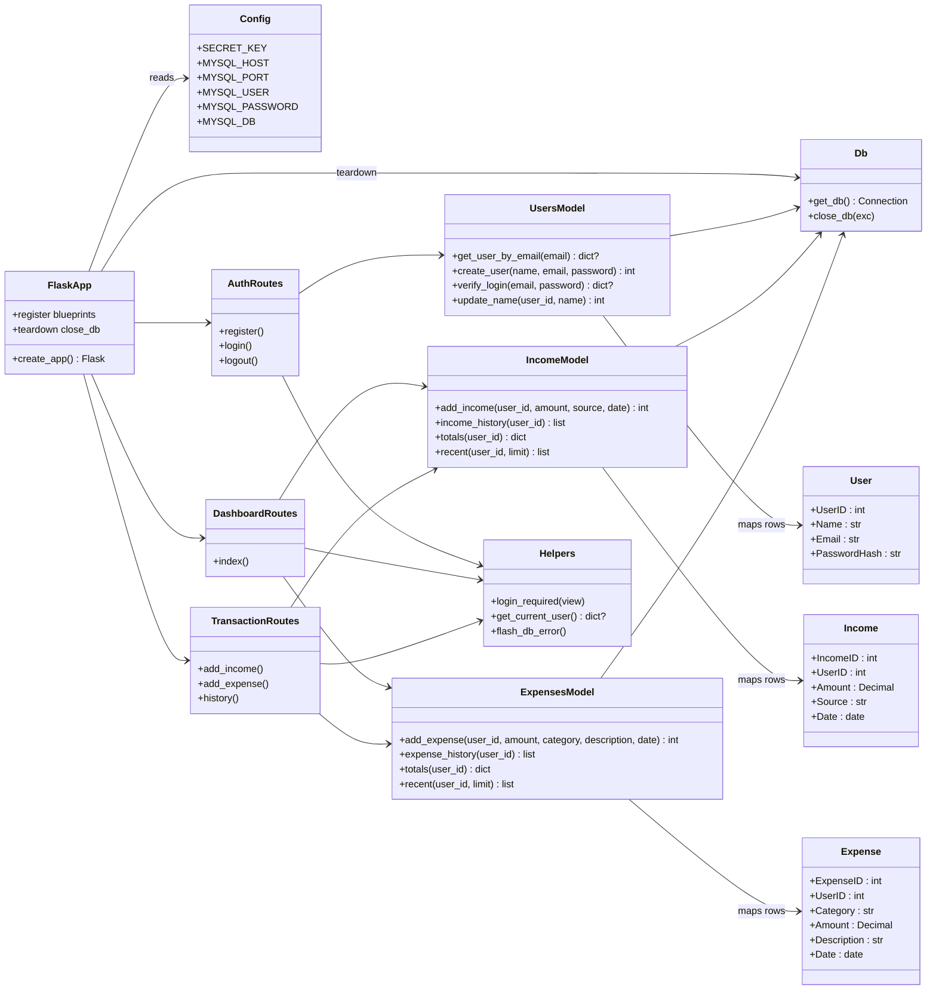

# Class Diagram — Personal Expense Tracker (CI-03)

Reflects the **v1.0** implementation (Flask + PyMySQL, function-oriented modules).

## Notes
- Route modules are Flask blueprints; models are plain query modules over PyMySQL `DictCursor` rows.
- Session state holds only `user_id`; the user row is re-fetched per request (`get_current_user`).
- Future versions add classes (e.g. `Category`, `Budget`, `ReportExporter`) without changing this structure — extension points are the `models` and `routes` packages.
