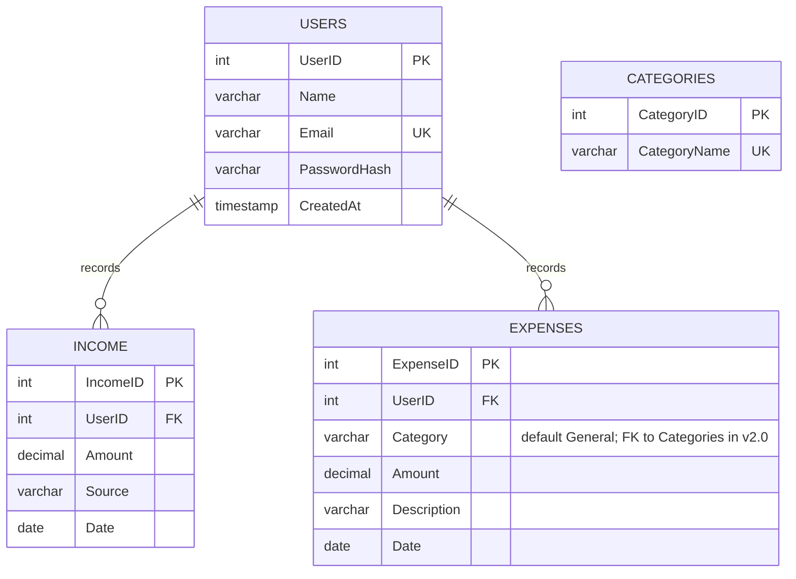

# Database Design — ER Diagram (CI-04)

State for release **v1.0**.

## Table Definitions

### Users
| Column | Type | Constraints |
|---|---|---|
| UserID | INT UNSIGNED | PK, AUTO_INCREMENT |
| Name | VARCHAR(100) | NOT NULL |
| Email | VARCHAR(255) | NOT NULL, UNIQUE |
| PasswordHash | VARCHAR(255) | NOT NULL (PBKDF2 salted hash) |
| CreatedAt | TIMESTAMP | NOT NULL, DEFAULT CURRENT_TIMESTAMP |

### Income
| Column | Type | Constraints |
|---|---|---|
| IncomeID | INT UNSIGNED | PK, AUTO_INCREMENT |
| UserID | INT UNSIGNED | NOT NULL, FK → Users(UserID) ON DELETE CASCADE |
| Amount | DECIMAL(10,2) | NOT NULL, CHECK (Amount > 0) |
| Source | VARCHAR(100) | NOT NULL |
| Date | DATE | NOT NULL |
| Index | idx_income_user_date (UserID, Date) | |

### Expenses
| Column | Type | Constraints |
|---|---|---|
| ExpenseID | INT UNSIGNED | PK, AUTO_INCREMENT |
| UserID | INT UNSIGNED | NOT NULL, FK → Users(UserID) ON DELETE CASCADE |
| Category | VARCHAR(50) | NOT NULL, DEFAULT 'General' (FK to Categories planned v2.0) |
| Amount | DECIMAL(10,2) | NOT NULL, CHECK (Amount > 0) |
| Description | VARCHAR(255) | NULL |
| Date | DATE | NOT NULL |
| Index | idx_expense_user_date (UserID, Date) | |

### Categories
| Column | Type | Constraints |
|---|---|---|
| CategoryID | INT UNSIGNED | PK, AUTO_INCREMENT |
| CategoryName | VARCHAR(50) | NOT NULL, UNIQUE |

## Planned Evolution (v2.0)
- Add `Expenses.CategoryID INT UNSIGNED NULL` + FK → `Categories(CategoryID)`.
- Backfill `CategoryID` from the existing text `Category` column.
- Enforce `CategoryID NOT NULL` afterwards.

Scripts: `src/database/schema.sql`, `src/database/seed.sql` (CI-06).
