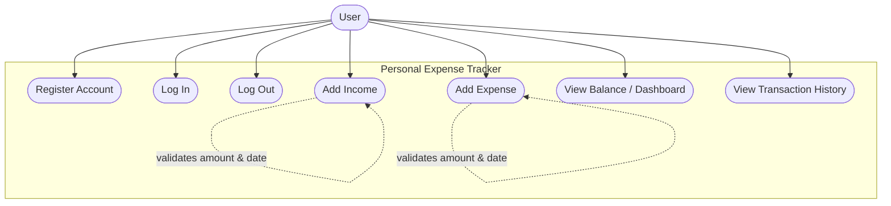

# Use Case Diagram — Personal Expense Tracker (CI-02)

Covers release **v1.0**. Actor: a single **User** (any registered person).

## Use Case Descriptions

| ID | Use case | Actor | Precondition | Main flow | Postcondition |
|---|---|---|---|---|---|
| UC-01 | Register Account | Visitor | None | Enter name, email, password → system validates and creates account | Account exists; user can log in |
| UC-02 | Log In | Registered user | Account exists | Enter email + password → system verifies hash → session starts | User sees dashboard |
| UC-03 | Log Out | Logged-in user | Session active | Click Logout | Session cleared |
| UC-04 | Add Income | Logged-in user | Logged in | Enter amount, source, date → system validates → record saved | Income in history; totals updated |
| UC-05 | Add Expense | Logged-in user | Logged in | Enter amount, category, description, date → record saved | Expense in history; totals updated |
| UC-06 | View Dashboard | Logged-in user | Logged in | Open home page → totals, balance, 5 recent transactions shown | No data change |
| UC-07 | View History | Logged-in user | Logged in | Open History page → all transactions, newest first | No data change |

## Alternative flows
- **UC-01:** Email already registered → error message, form preserved.
- **UC-02:** Wrong credentials → generic "Invalid email or password."
- **UC-04/05:** Invalid amount/date → error flash, form values preserved.
- **Any:** Database unreachable → friendly "database unavailable" message (FR-10).
